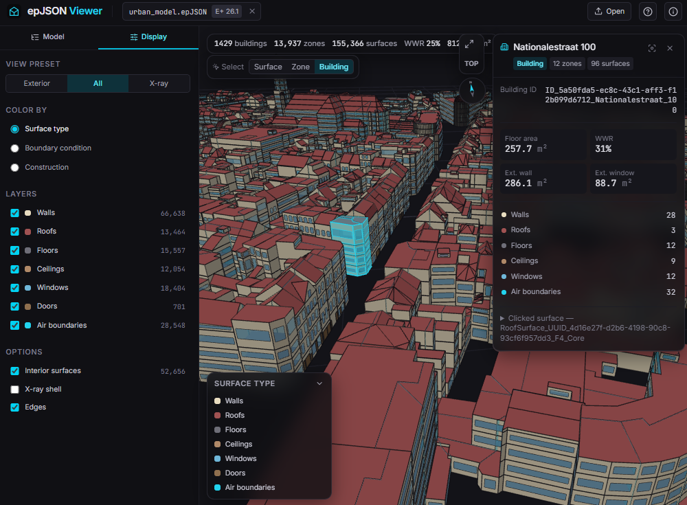

# epJSON Viewer

A browser-based 3D geometry viewer for [EnergyPlus](https://energyplus.net/) **epJSON** files.
EnergyPlus's DXF export is hard to work with; this viewer renders model geometry directly from the
simulation input, entirely in the browser. **Files never leave your machine.**



## Features

- **Geometry — every one of the 30 geometry-bearing epJSON object types**: the detailed family
  (`BuildingSurface:Detailed`, `Wall`/`RoofCeiling`/`Floor:Detailed`,
  `FenestrationSurface:Detailed`, `Shading:*:Detailed`); the simplified rectangular family
  (`Wall:Exterior`/`Adiabatic`/`Underground`/`Interzone`, `Roof`, `Ceiling:*`, `Floor:*`,
  `Window`/`Door`/`GlazedDoor` and their `:Interzone` variants, `Shading:Site`/`Building`); and
  parametric attached shading (`Shading:Overhang`, `Shading:Fin`, both `:Projection` too).
  Windows are cut as real holes in their host walls; concave polygons go through ear-clipping
  triangulation
- **EnergyPlus-exact coordinate handling**: relative/world coordinate systems (including the
  separate `rectangular_surface_coordinate_system`), zone origins,
  `direction_of_relative_north`, building `north_axis` (matches `SurfaceGeometry.cc`)
- **Model tree**: buildings → zones → surfaces → fenestration, with search; buildings are grouped
  from urban-export zone naming (`ID_<uuid>_<street>_<no>[_<zone>]`), where the UUID identifies the
  building and every zone sharing it is one building
- **Render modes**: by surface type, by outside boundary condition, by construction — with adaptive legend
- **View presets**: All (default) / Exterior / X-ray (ghosted shell reveals interior zoning)
- **Layers**: per-category visibility incl. interior surface pairs and
  `Construction:AirBoundary` air walls; matched interior pairs are offset to prevent z-fighting
- **Inspection**: click any surface for construction, boundary condition, computed area / tilt /
  azimuth, link to the paired surface, raw epJSON
- **Selection level**: a Surface / Zone / Building toggle decides how far a click expands — pick one
  wall to select its whole zone or building, with aggregate floor / wall / window area and WWR for
  the group. Building only appears when the file holds more than one building, as urban exports do;
  a conventional single-building model just offers Surface / Zone
- **Scale**: 30 MB+ urban models (750 zones, 22,000 surfaces) parse in a Web Worker with progress
  feedback and render as merged geometry batches
- Model statistics (WWR, floor area), drag & drop loading

## Usage

Open the deployed page and drop an `.epJSON` file, or try the bundled
anonymized demo models. Convert IDF to epJSON with:

```sh
energyplus --convert-only model.idf
```

| Action | Control |
| --- | --- |
| Orbit / pan / zoom | Left-drag / right-drag / scroll |
| Select | Click |
| Selection level (surface / zone / building) | Overlay toggle, or `S` to cycle (only the levels the model has) |
| Fit view / deselect | `F` / `Esc` |
| Frame building, zone or surface | Double-click it in the tree |

### Project layout

```
src/core/     epJSON parsing, transforms, triangulation, buffers — pure TS, no DOM
src/worker/   Web Worker wrapping the core pipeline
src/three/    SceneManager (camera, picking, highlights), materials/palettes
src/stores/   Pinia store (load status, selection, visibility, render mode)
src/components/  Vue 3 UI (tree, layers, selection card, overlays)
scripts/      anonymize.py (demo generation), verify-render.mjs (headless check)
```

### Data privacy

`data/` (real research models with addresses) is git-ignored. Bundled demo files in
`public/samples/` are generated with `scripts/anonymize.py`, which strips addresses, building names
and site location, and replaces every real UUID with a synthetic sequential one (kept only so the
demo preserves its building/zone structure); only the (local-coordinate) geometry itself remains.

## Authors

Developed by **Richard Dean Morales** (principal developer and contact,
<richarddean.morales@uantwerpen.be>) at the Energy and Materials in Infrastructure and Buildings
(EMIB) Research Group, Faculty of Applied Engineering, University of Antwerp.

If you use this software in academic work, please cite it — see [CITATION.cff](CITATION.cff), or use
the "Cite this repository" button on GitHub.

## License

Licensed under the [Apache License 2.0](LICENSE).

Copyright 2026 Energy and Materials in Infrastructure and Buildings (EMIB) Research Group,
University of Antwerp. See [NOTICE](NOTICE) for the attribution notice that must accompany
redistributions, and [THIRD-PARTY-NOTICES.md](THIRD-PARTY-NOTICES.md) for the licenses of bundled
third-party components (three.js, Vue, Pinia, earcut, Lucide, and the Inter / JetBrains Mono fonts).
